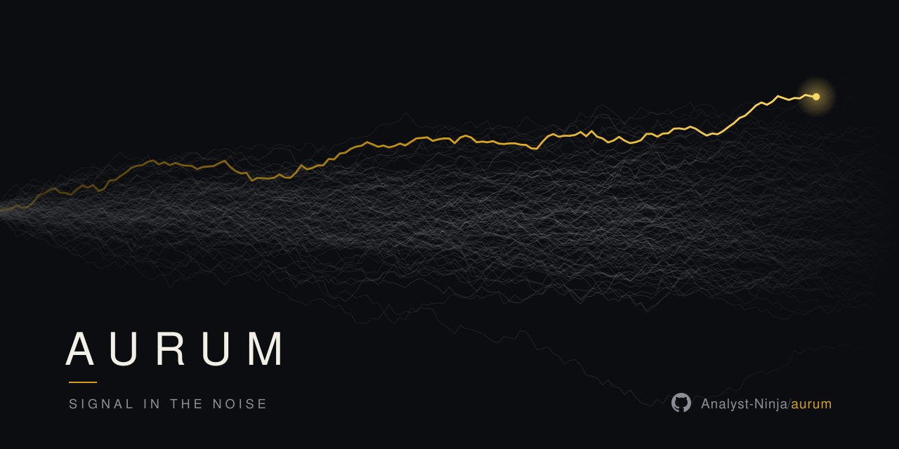
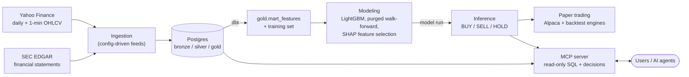

# AURUM



**Analytics & Unified Research for Market** — turns raw market prices and SEC filings into ML-ready features, trains a model on them, and emits explained BUY / SELL / HOLD decisions. It runs unattended on AWS and can place those decisions as **paper** trades on Alpaca. It never trades real money.

> Ask an AI agent *"Which tech stocks have P/E < 20 and grew revenue > 15% last quarter?"* through the MCP server, or run the model's latest decisions and watch them trade on paper.

**Honest status:** the pipeline works end to end, but the model signal is weak (holdout IC 0.007, break-even cost about 18 bps). Every decision output carries that caveat. This is a research platform, not a money machine.

## How it works



1. **Ingest** — Yahoo prices and EDGAR statements are pulled by small config-driven feeds and written straight into Postgres. Market feeds are incremental (resume from a per-symbol watermark); EDGAR feeds reload fully but are skipped if the table is fresh.
2. **Warehouse** — dbt builds a medallion: **bronze** (mirror of landing tables) → **silver** (cleaned staging, then engineered fundamentals and technicals) → **gold** (feature marts and the training set). ML and MCP read only from gold.
3. **Learn** — LightGBM regression on `fwd_ret_5d_excess` (5-day market-neutral excess return), purged walk-forward validation so folds cannot leak, SHAP values (LightGBM's built-in `pred_contrib`) to prune the feature set, a flat-file model registry under `models/`.
4. **Decide** — the newest trained run scores the latest date: top decile BUY, bottom decile SELL, rest HOLD. A stale-date guard refuses old data. `replay` backtests that rule against a momentum baseline.
5. **Trade on paper** — `src/paper` turns decisions into Alpaca paper orders, keeps a ledger, and cross-checks backtests across four engines.
6. **Ask** — a local or hosted MCP server lets AI agents inspect the gold tables, run read-only SQL and fetch decisions.

Every step on AWS is scheduled (see [Deployment](#deployment)).

## What is built

| Part | What it does | Where | Docs |
|---|---|---|---|
| Ingestion | Yahoo OHLCV (1d, 1min) and EDGAR income / cash-flow / balance-sheet statements (yearly + quarterly) into Postgres | `src/ingestion/` | [Framework guide](docs/ingestion/datasource-framework.md), [EDGAR strategy](docs/ingestion/edgar-incremental-ingestion.md) |
| Warehouse | dbt medallion on Postgres: 8 bronze, 3 staging, 5 intermediate, 4 gold models, 3 seeds, full test suite. `gold.mart_features` is about 2.9M rows across 503 symbols, 2000 to today | `src/transformation/aurum_dwh/` | [Warehouse guide](docs/warehouse/dwh-medallion.md), [Data dictionary](docs/warehouse/data-dictionary.md) |
| Modeling | train, evaluate, select-features, compare, backtest, predict, export | `src/modeling/` | [Modeling design](docs/modeling/modeling-design.md), [Runbook](docs/modeling/pipeline-runbook.md) |
| Inference | `decide` and `replay` from the newest trained run | `src/inference/` | [Inference](docs/inference/inference.md) |
| MCP server | tools `list_tables`, `describe_table`, `run_query`, `refresh_catalog`, `get_decisions`, `score_symbols`; stdio or streamable-HTTP | `src/mcp/` | [MCP design](docs/mcp/mcp-server-design.md) |
| Paper trading | Alpaca paper broker, simulated broker, ledger, vectorbt / backtrader / Lumibot cross-check | `src/paper/` | [Paper trading](docs/paper/paper-trading.md) |
| AWS | RDS, ECS Fargate, Step Functions, EventBridge, EFS, S3, SNS, MCP host on EC2 — all Terraform | `infra/terraform/` | [AWS deployment](docs/infra/aws-deployment-plan.md), [IaC](docs/operations/infra-as-code.md) |
| CI/CD | lint, tests, Sonar, Terraform validate, gated apply that ships images | `.github/workflows/` | [CI/CD](docs/operations/cicd.md) |

## Quickstart

Python 3.12, managed with [uv](https://docs.astral.sh/uv/). Postgres runs locally (or on RDS). The full walkthrough from an empty machine to a backtest is in [`docs/operations/local-setup.md`](docs/operations/local-setup.md).

**1. `.env` in the repo root** (never commit it):

```
SEC_USER_AGENT=Your Name your@email.com   # EDGAR returns 403 without an honest one
HOST=localhost
PORT=5432
AURUM_USERNAME=...
AURUM_PASSWORD=...
ALPACA_API_KEY=...        # only for src/paper
ALPACA_SECRET_KEY=...     # only for src/paper
```

**2. Install.** Dependencies are split into groups so each workload installs only what it needs:

| Group | Holds | Needed for |
|---|---|---|
| default | pandas, sqlalchemy, yfinance, edgartools, … | ingestion |
| `dbt` | dbt-postgres | warehouse build |
| `modeling` | lightgbm, scikit-learn, scipy, pyarrow, matplotlib, boto3, asyncpg | modeling, inference, tests |
| `mcp` | mcp SDK | MCP server |
| `paper` | alpaca-py | paper trading |
| `backtesting` | backtrader, vectorbt | backtest cross-check |
| `dev` | ruff, pytest, jupyter | development |

```bash
uv sync --locked --no-build                     # ingestion only
uv sync --group modeling --group mcp --group paper --group backtesting   # what CI installs
```

**3. Ingest.** One YAML fully specifies a run:

```bash
# Yahoo daily OHLCV, full load (the default)
uv run python -m src.ingestion.cli -c src/ingestion/configs/yahoo/ohlcv_1d.yaml
# same feed, incremental from the landing-table watermark
uv run python -m src.ingestion.cli -c src/ingestion/configs/yahoo/ohlcv_1d.yaml -f False
# EDGAR quarterly income statements (-d = run date, default today)
uv run python -m src.ingestion.cli -c src/ingestion/configs/edgar/income_statements_quarterly.yaml -d 2026-01-01
```

`-f` defaults to **True** (full load), so incremental runs need `-f False`. On an empty database a full load runs whatever `-f` says.

**4. Build the warehouse:**

```bash
cd src/transformation/aurum_dwh
uv run --group dbt dbt deps && uv run --group dbt dbt seed
uv run --group dbt dbt build        # bronze → silver → gold, with tests
```

**5. Train, decide, trade on paper:**

```bash
uv run --group modeling python -m src.modeling.cli train -c src/modeling/configs/lgbm_xs_excess_5d.yaml
uv run --group modeling python -m src.inference.cli decide
uv run --group paper python -m src.paper.cli rebalance --dry-run
```

**6. MCP server:** `uv run --group mcp python -m src.mcp.server`

**Or use Docker.** One pinned image runs all four workloads: `ingest`, `dbt`, `model`, `infer`. It reaches the host's Postgres through `host.docker.internal`:

```bash
docker compose -f docker-compose.modeling.yml build trainer
docker compose -f docker-compose.modeling.yml run --rm trainer ingest -c src/ingestion/configs/yahoo/ohlcv_1d.yaml -f False
docker compose -f docker-compose.modeling.yml run --rm trainer dbt build
docker compose -f docker-compose.modeling.yml run --rm trainer model train -c src/modeling/configs/lgbm_xs_excess_5d.yaml
docker compose -f docker-compose.modeling.yml run --rm trainer infer decide
```

## Deployment

Runs unattended on AWS (us-east-1). One image on ECR runs as four ECS Fargate tasks, orchestrated by three Step Functions state machines on EventBridge Scheduler crons (UTC):

| State machine | Cron | Runs |
|---|---|---|
| `aurum-daily-market` | `cron(30 22 ? * MON-FRI *)` | ingest-market → dbt |
| `aurum-semimonthly-edgar` | `cron(0 6 1,15 * ? *)` | ingest-market → ingest-edgar → dbt |
| `aurum-monthly-train` | `cron(0 12 1 * ? *)` | train |

| Task | Size | Does |
|---|---|---|
| `aurum-ingest-market` | 2 vCPU / 8 GB | Yahoo 1d then 1min, incremental |
| `aurum-ingest-edgar` | 1 vCPU / 4 GB | six EDGAR configs, each truncate then load |
| `aurum-dbt` | 2 vCPU / 4 GB | `dbt seed` and `dbt build` |
| `aurum-train` | 8 vCPU / 32 GB | full train → evaluate → SHAP select → narrowed train → compare → backtest → export to S3 |

Rules that matter:

- **dbt runs after every ingest**, so gold is never as-of two different dates. `dbt` and `train` stay separate states: a dbt failure must never reach training.
- Failures publish to the `aurum-alerts` SNS topic **and** end the execution red.
- On the 1st the machines run in order: market + EDGAR + dbt at 06:00, train at 12:00, market + dbt at 22:30.
- Models and data live on EFS; run reports are exported to a private S3 bucket (365-day retention). RDS is Postgres 17 (`db.m7g.large`); a monthly budget guardrail is set (default $150).
- An optional MCP host (`t3.micro` EC2) serves a read-only role on `gold` and `silver`. It has no public ingress; reach it with an SSM port-forward (`scripts/mcp-tunnel.sh`).
- Cost and security caveats (the RDS security group defaults to `0.0.0.0/0`, the MCP server has no auth of its own) are in [`docs/security/risks.md`](docs/security/risks.md).

## CI/CD

GitHub Actions, all pinned by commit SHA:

- **`ci.yml`** — on `main`, `develop`, `epic/*` and PRs: install groups `modeling mcp paper backtesting`, `ruff check src/ main.py`, `pytest tests/` with coverage, Sonar scan.
- **`terraform.yml`** — `validate` (fmt, validate, tflint) on pushes and PRs; `apply` on merge to `main` only, behind a reviewer-gated environment, via GitHub OIDC. It builds and pushes the app image and the slim `mcp-<sha>` image if their tags are missing in the immutable ECR repo, then applies Terraform. So **a merge that changes `src/` ships to Fargate with no local step.** Rollback: `make push` / `-var="image_tag=<older sha>"`.
- **`bootstrap.yml`** — repairs the OIDC role. **`terraform-destroy.yml`** — manual teardown, you must type `destroy-aurum`.

## Not built yet

- Kafka producers and consumers, the realtime websocket feed, and news ingestion (no sentiment exists anywhere).
- Snowflake — the dbt project targets Postgres.
- Airflow — scheduling is Step Functions. `airflow/` and `src/feed/` are empty placeholders, and `main.py` is empty.
- Streaming (live) inference — inference is batch, daily.
- Real-money trading and MLflow. Paper trading only; the registry is flat files.

`docs/architecture/TECHNICAL_SPEC.md` describes the full target system; everything else in `docs/` describes what exists.

## Data sources & cost

Market and filing data are free: Yahoo Finance (unofficial API), SEC EDGAR (public, 10 req/s cap, honest `User-Agent` required), the Wikipedia S&P 500 list, and an Alpaca paper account (free, IEX feed). The AWS footprint is the real cost; the guardrail budget defaults to $150 a month.

## Documentation

Full index with folder layout: [`docs/README.md`](docs/README.md).

| Doc | Content |
|-----|---------|
| [Local setup](docs/operations/local-setup.md) | Empty machine → warehouse → model → decisions → backtest |
| [Technical specification](docs/architecture/TECHNICAL_SPEC.md) | The target architecture and build phases |
| [Ingestion framework](docs/ingestion/datasource-framework.md) | Datasources, feeds, configs; how to add a source |
| [Warehouse guide](docs/warehouse/dwh-medallion.md) | Layers, model DAG, feature formulas, point-in-time lag, how to add a feature |
| [Modeling design](docs/modeling/modeling-design.md) | Framing, target, metrics, known biases; five companion docs |
| [Inference](docs/inference/inference.md) | The decision rule and replay |
| [MCP server](docs/mcp/mcp-server-design.md) | Tools, transports, hosting |
| [Paper trading](docs/paper/paper-trading.md) | Alpaca, ledger, backtest engines |
| [AWS deployment](docs/infra/aws-deployment-plan.md) | Schedule DAG, sizing, troubleshooting |
| [Infrastructure as code](docs/operations/infra-as-code.md) | Terraform layout, bootstrap, deploy script |
| [CI/CD](docs/operations/cicd.md) | Workflows, gates, image shipping |
| [Training container](docs/operations/training-container.md) | The one image and compose service |
| [Security review](docs/security/risks.md) | Known risks |

## Repository layout

```
src/ingestion/        feeds, datasources, configs, freshness gate, truncate
src/transformation/   aurum_dwh dbt project (bronze / silver / gold, seeds, tests)
src/modeling/         data, models, evaluate, explain (SHAP), backtest, export
src/inference/        decide, replay
src/mcp/              FastMCP server, catalog
src/paper/            broker, ledger, live loop, backtesting engines
src/utils/            env, paths, symbol lists
infra/terraform/      AWS stack + bootstrap/ (GitHub OIDC)
docker/, scripts/     image, entrypoint, deploy.sh, mcp-tunnel.sh
tests/                unit tests per package
docs/                 see docs/README.md
```
